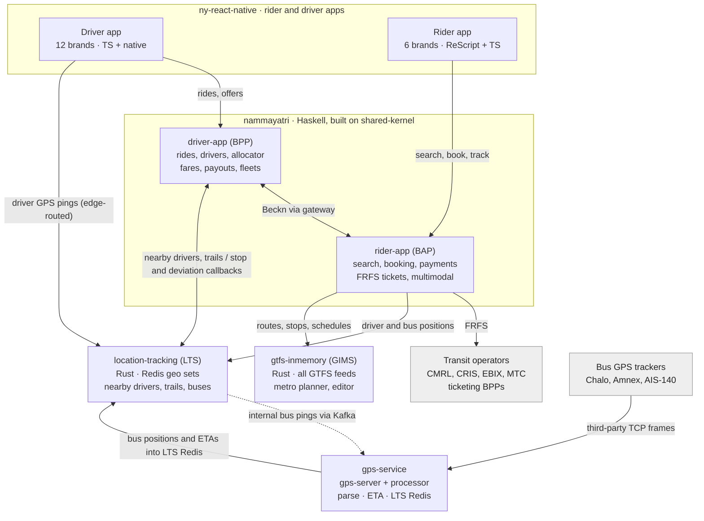
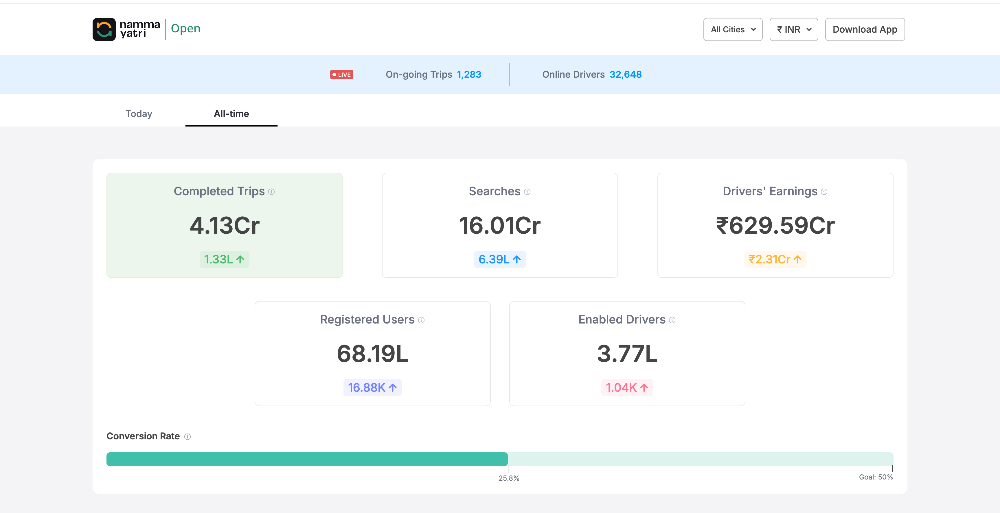
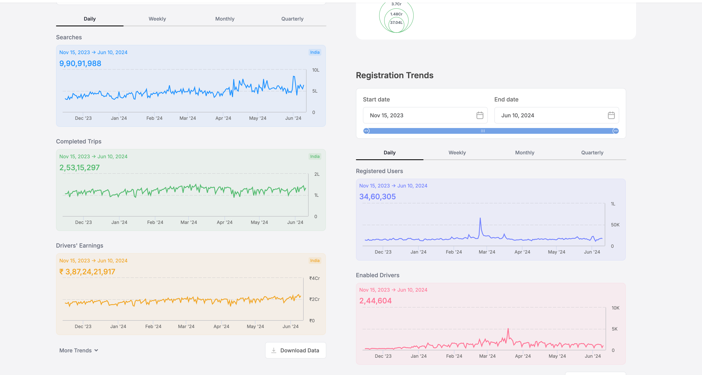

# 🛺 Namma Yatri 🚖

**Open and Driver Centric Mobility Platform**

## 🌟 Vision
Namma Yatri aims to empower service providers with a high-tech, cost-effective app and open data platform. Our vision is centered on the following principles:

1. **Zero Commission**: Ensuring no commission fees for drivers, promoting fair earnings and economic empowerment for service providers.
2. **Open**: Utilizing open data platforms, open code, and open networks to foster transparency, innovation, and collaboration within the community.
3. **Optimize**: Achieve population scale growth with utility-like pricing by continuously optimizing maps, cloud, and development costs, all while maintaining high reliability and rich user experience.
4. **Multimodal**: Supporting various modes of transport to provide comprehensive, integrated mobility solutions for a seamless user experience.
5. **Shared Transport**: Promoting shared mobility options to reduce traffic congestion, lower costs, and minimize carbon emissions, contributing to a sustainable future.

As engineers, we often seek opportunities where one person can serve millions of others. Namma Yatri is an effort to enable the careers of those who serve one-to-one, like auto drivers who transport people each and every day. These drivers indirectly serve millions of customers over time.

Here is a [video from our founder](https://www.youtube.com/watch?v=NnyoxiiZLZg) explaining the vision of Namma Yatri:

## 🌱 Core Values

### 👥 Community-first
Mobility must be owned by the community of citizens and drivers who collaborate to create a thriving, equitable, and sustainable environment. Participatory development from the community helps build products to solve large-scale problems like mobility.

### 🚗 Citizens as owners
Drivers invest in their vehicles and work hard every day. Citizens pay for and use the service. They both should own the platform, offering quality service at a fair price, without intermediaries dictating terms or prices.

### 👐 Open Platform
Customers shall participate in community efforts by using the open system, providing feedback, and improving drivers' lives. Our data and roadmap will be open for feedback. The team will strive to be efficient, prioritize the critical few, and do more with less.

### 💡 Tech and People are enablers
Mobility is an engineering problem, and technology can make it more efficient, reliable, and sustainable. We need both tech innovations and human involvement. Empathy and support for both citizens and drivers are crucial.

### 🌍 Sustainable Growth
We aim to solve complex, long-term problems sustainably, avoiding unsustainable tactics like discounts and incentives. We pursue initiatives that are financially, environmentally, and psychologically sustainable, promoting shared mobility and efficient public transportation to reduce traffic, cost, and carbon emissions.

## ❓ Why Solve This Problem?
Mobility is critical to economic growth, social progress, and individual well-being. People's livelihoods depend on mobility, but current systems could be more efficient, sustainable, and accessible to the masses. To improve this, mobility should be community-driven, open, tech-enabled, and shared.

Join us in this endeavor to transform mobility. We look forward to your contribution and support!

## 🏗️ Architecture: the six repos

Six repos run the mobility stack. This Haskell monorepo holds the ride-hailing and public-transport business logic, one Haskell library underpins it, three Rust services handle location and transit data, and one React Native repo ships the apps. Ride hailing is served end to end by our own code over the Beckn/ONDC protocol. Public transport ticketing is served by rider-app talking to external transit operators, with timetable and live-bus data supplied by the two transit services.

| Repo | Stack | What lives there | Talks to |
| --- | --- | --- | --- |
| [nammayatri](https://github.com/nammayatri/nammayatri) (this repo) | Haskell, ~48 Cabal packages, Postgres + Redis + Kafka + ClickHouse | rider-app (BAP, :8013), dynamic-offer-driver-app (BPP, :8016), driver-offer-allocator, schedulers, kafka-consumers, dashboard APIs, FRFS ticketing, NammaDSL-generated code | Beckn gateway and external BPPs, LTS, GIMS (client named Nandi), Juspay and other providers via shared-kernel |
| [shared-kernel](https://github.com/nammayatri/shared-kernel) | Haskell library `mobility-core`, pinned as a Nix flake input | Flow monad, Servant scaffolding, Beckn types and signing, Beam/Esqueleto/Hedis/Kafka/ClickHouse wrappers, metrics, encryption, errors, ~30 external-integration families (maps, SMS, WhatsApp, payments, payouts, FCM, Idfy/HyperVerge/DigiLocker, SOS, insurance, support) | Linked into every nammayatri service; no runtime of its own |
| [location-tracking-service](https://github.com/nammayatri/location-tracking-service) (LTS) | Rust (actix-web), Redis cluster only, produces Kafka | Driver location ingest, Redis geo sets, nearby-driver search, per-ride trails, airport and station driver queues, stop and route-deviation detection, geofence and blacklist polygons. For buses only a door: internal device pings in, Kafka out; its Redis hosts the bus positions gps-processor writes | Called by BPP, allocator and rider-app; calls back BPP/BAP internal endpoints; publishes `location-updates` to kafka-consumers |
| [gtfs-inmemory-server-rust](https://github.com/nammayatri/gtfs-inmemory-server-rust) (GIMS) | Rust (actix-web), Postgres, arc-swap in-memory snapshots | All city GTFS feeds in memory (routes, stops, trips, stop times, fares), metro A* trip planner, bus schedules, vehicle service tiers, MTC Chennai operator and depot backend, conductor-app backend, and a full GTFS editor with maker-checker change sets | Called by rider-app, BPP (`lib/gtfs-data-server`), gps-processor and dashboards; reads ClickHouse pings for map lines |
| [gps-server](https://github.com/nammayatri/gps-server) (gps-service) | Rust, two crates: gps-server (Tokio TCP ingest) and gps-processor (Kafka consumer); Kafka in, LTS Redis out | gps-server: device-facing TCP endpoint; parses Chalo, Amnex, AIS-140 and MQTT frames, normalises timestamps, drops bad fixes. gps-processor: matches pings to vehicle, trip and route, detects stop arrivals, computes stop ETAs, writes positions and ETAs to the LTS Redis | Third-party trackers in; Kafka between the two crates, also fed by LTS for internal devices; reads routes and stops from GIMS; rider-app reads its output from the LTS Redis |
| [ny-react-native](https://github.com/nammayatri/ny-react-native) | React Native; rider app in ReScript + TypeScript, driver app in TypeScript with native Kotlin/Swift | Rider app (ride hailing + metro/bus multimodal, 6 brands), driver app (12 brand flavors), shared `ny-common` native module, OpenAPI-driven API client generator | Rider app calls rider-app only; driver app calls BPP, and its location pings are routed at the edge to LTS |

### How they fit together

Shaded boxes are outside the six repos. The apps only ever talk to nammayatri, with one exception: driver GPS pings are routed at the edge to LTS. Bus GPS takes a different door: third-party trackers send raw frames to gps-server, internal devices ping LTS, both land in Kafka, and gps-processor turns them into positions and ETAs in the LTS Redis. nammayatri owns all business state; LTS owns the hot location data; GIMS owns transit reference data.

### Ride hailing path

Ride hailing uses three repos at runtime: ny-react-native on both phones, nammayatri for all business logic, and LTS for anything involving a coordinate. shared-kernel is compiled into nammayatri rather than deployed.

1. The rider app calls rider-app (BAP). rider-app builds a Beckn `search` and sends it through the gateway to dynamic-offer-driver-app (BPP). Both ends sign and verify requests with shared-kernel's Beckn signing.
2. The BPP asks LTS for nearby drivers (`/internal/drivers/nearby`) from Redis geo sets, prices the trip with the fare policy, and the allocator pushes ride requests to drivers over FCM. The chain then follows `select`, `init`, `confirm` with callbacks back to the BAP.
3. During the ride the driver app posts location pings. The driver API host routes them straight to LTS, which stores the trail, detects stops and route deviation, and calls the BPP's bulk-location and detection endpoints. The rider app polls rider-app for the driver's position, and rider-app fetches it from LTS.
4. LTS publishes every ping to the `location-updates` Kafka topic. The kafka-consumers service in nammayatri writes the analytics trail. Payments, SMS, notifications and KYC all go out through shared-kernel's provider interfaces.

### Public transport path

Public transport is BAP-only: rider-app sells the ticket, but the operator (CMRL, CRIS, EBIX, MTC) is the BPP. The two transit services supply what the operators do not: timetables and live bus positions.

1. **Timetable data.** The Nandi pipeline preprocesses each city's GTFS feed into a snapshot. GIMS loads every feed in memory and serves routes, stops, route-stop mappings, metro A-to-B plans and bus schedules. rider-app reads it through the Nandi client for FRFS search and multimodal journeys. Ops edit the feed in the GIMS GTFS editor, and a committed change-set reloads every pod within seconds.
2. **Live buses.** Third-party bus trackers send raw frames over TCP to gps-server, which parses each device protocol, drops bad fixes and publishes clean pings to Kafka. Buses with our own internal devices ping LTS instead, and LTS forwards them to the same Kafka topic; that is LTS's only bus role. gps-processor consumes the topic, matches each ping to a vehicle, trip and route, computes stop ETAs, and writes positions and ETAs into the LTS Redis. rider-app reads them from there to serve nearby buses and track a journey leg.
3. **Ticketing.** rider-app runs the FRFS `search`, `select`, `init`, `confirm` flow against the operator, either over ONDC Beckn with async callbacks or over the operator's direct synchronous API. Fares, tickets and passes are stored in rider-app; payment goes through Juspay via shared-kernel.
4. **Operator side.** For MTC Chennai, GIMS also acts as the depot and conductor backend: waybills, crew, devices and trip actions. dynamic-offer-driver-app's fleet-operator flows call it through `lib/gtfs-data-server`, and the dashboard proxies its operator APIs.

Backend internals (services, ports, packages) are documented in [`docs/backend/01-architecture-overview.md`](docs/backend/01-architecture-overview.md).

## 🎯 Milestone and Growth
With an ever-increasing number of rides facilitated, our platform is demonstrating its effectiveness and scalability. You can explore the real-time data and see the traction [here](https://nammayatri.in/open/?rides=All&tl=at).

Here are some snapshots of our dashboard:

*Comprehensive overview of the total rides completed, registered users, searches, and drivers' earnings.*

*Daily trends of searches, completed trips, drivers' earnings, registered users, and enabled drivers, showing detailed metrics over time.**

## 🤝 Get Involved
Explore the code, provide feedback, and contribute to the project. Together, we can create a scalable, efficient, safe, and sustainable transportation network for our city.

### Community Engagement
Join our [GitHub Discussions](https://github.com/orgs/nammayatri/discussions) to ask questions and explore ideas.

### Project Setup
Instructions to build and run the project can be found in the sub-project directories - [Backend](https://github.com/nammayatri/nammayatri/blob/main/Backend/README.md#getting-started) and [Frontend](https://github.com/nammayatri/nammayatri/blob/main/Frontend/README.md).

### Contributing Guidelines
We believe in the power of open-source. This repository aims to foster an open development platform for the mobility stack, where anyone can inspect and contribute. We welcome contributions in the form of bug reports, code patches, documentation updates, feature requests, and notifications of breaking changes in dependencies. Please read our [contributing guidelines](https://github.com/nammayatri/nammayatri/blob/main/docs/CONTRIBUTING.md) before you start.

Happy Contributing

## ✨ Thanks to all contributors

Thank you for your support in nammayatri's growth. Keep up the great work! 🥂

